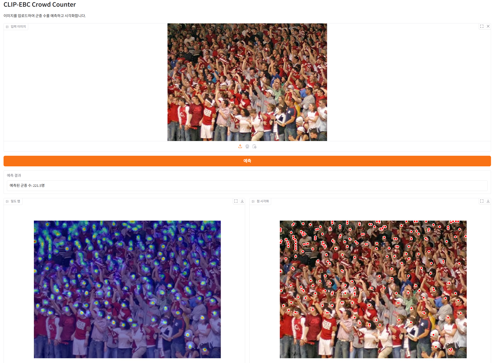

# CLIP-EBC: Crowd Counting with CLIP

[Original Repo](https://github.com/Yiming-M/CLIP-EBC) 기반 군중 계수 추론 파이프라인.
ONNX, TensorRT FP32, TensorRT Mixed Precision, PyTorch 4개 백엔드를 통일된 인터페이스로 제공.

## 백엔드 비교

> 측정 환경: NVIDIA RTX PRO 6000 (97GB), CUDA 13.0, TensorRT 10.16
> TRT 엔진은 `max_batch_size=1024`로 빌드한 기준. max_batch를 줄이면 VRAM도 비례 감소.

| 백엔드 | 속도 (ONNX 대비) | VRAM (모델 로드) | 정확도 (count diff) | 모델 크기 |
|---|---|---|---|---|
| ONNX | 1.0x (기준) | ~0.5 GB | - | 371 MB |
| TRT FP32 (max_batch=1024) | **1.4x** | ~11.9 GB | < 0.05 | 372 MB |
| TRT Mixed (max_batch=1024) | **2.5x** | ~4.4 GB | < 1.0 | 188 MB |

**TRT VRAM은 max_batch_size에 비례합니다:**

| max_batch_size | TRT Mixed VRAM |
|---|---|
| 64 | ~0.6 GB |
| 128 | ~0.8 GB |
| 256 | ~1.3 GB |
| 512 | ~2.3 GB |
| 1024 | ~4.4 GB |

> FHD(1920x1080)는 45 tiles이므로 `max_batch_size=64`면 충분. 4K 이상 대형 이미지를 처리한다면 더 높게 설정.

## 설치

```bash
conda create -n ebc python=3.12 -y
conda activate ebc

# 1. PyTorch (CUDA 버전에 맞는 index-url 사용)
pip install torch torchvision --index-url https://download.pytorch.org/whl/cu130

# 2. 나머지 종속성 (TensorRT 포함)
pip install -r requirements.txt
```

> PyTorch는 CUDA 버전별로 설치 URL이 다릅니다.
> - CUDA 13.0: `https://download.pytorch.org/whl/cu130`
> - CUDA 12.1: `https://download.pytorch.org/whl/cu121`
> - [PyTorch 공식 설치 가이드](https://pytorch.org/get-started/locally/) 참조

## 빠른 시작

### ONNX 추론

```python
from src.config import InferenceConfig
from src.onnx import ClipEBCOnnx

model = ClipEBCOnnx(InferenceConfig(model_path="assets/CLIP_EBC_nwpu_rmse_onnx.onnx"))

# 배치 추론 (여러 이미지)
counts = model.predict([img1, img2])  # List[float]

# 단일 이미지
count = model.predict_single("assets/289.jpg")  # float

# 추론 + 시각화 (density map + dot overlay)
counts, heat_overlays, dot_overlays = model.predict_dense_dot([img1, img2])
```

### TensorRT 추론

```python
from src.trt import ClipEBCTensorRT

model = ClipEBCTensorRT(InferenceConfig(
    model_path="assets/CLIP_EBC_nwpu_rmse_tensorrt_mixed.engine"
))
counts, heats, dots = model.predict_dense_dot([img1])
```

### TRT 엔진 빌드

```bash
# Mixed Precision (권장)
python -m src.trt.builder --mixed --output assets/CLIP_EBC_nwpu_rmse_tensorrt_mixed.engine

# FP32
python -m src.trt.builder --output assets/CLIP_EBC_nwpu_rmse_tensorrt.engine

# max_batch_size 조정 (VRAM 절약)
python -m src.trt.builder --mixed --max-batch 64 --output assets/my_engine.engine
```

Python API:
```python
from src.config import TRTBuildConfig
from src.trt import build_engine

build_engine(TRTBuildConfig(mixed_precision=True, max_batch_size=64))
```

### PyTorch 추론

```python
from src.pth import ClipEBCPth

model = ClipEBCPth(InferenceConfig(model_path="assets/CLIP_EBC_nwpu_rmse.pth"))
counts = model.predict([img1])
```

## CLI

```bash
python main.py --image assets/289.jpg
python main.py --image assets/289.jpg --backend trt_mixed --visualize all --save
```

## Gradio 데모

```bash
python app.py
```



## 프로젝트 구조

```
CLIP_EBC_ONNX/
├── src/                          # 추론 모듈 (메인 인터페이스)
│   ├── config.py                 #   InferenceConfig, TRTBuildConfig
│   ├── visualize.py              #   공통 시각화 (heat/dot overlay)
│   ├── onnx/model.py             #   ClipEBCOnnx
│   ├── trt/model.py              #   ClipEBCTensorRT
│   ├── trt/builder.py            #   build_engine() + CLI
│   ├── pth/model.py              #   ClipEBCPth
│   └── tests/
│       ├── test_multichannel_benchmark.py  # 멀티채널 벤치마크 + 마크다운 보고서 생성
│       ├── test_vram_benchmark.py          # VRAM + 속도 벤치마크
│       └── test_accuracy.py               # 3백엔드 정확도 비교
├── models/                       # CLIP 아키텍처 (PTH 추론 + ONNX 변환용)
├── configs/                      # 모델 설정 JSON
├── assets/                       # 모델 가중치 + 샘플 (자동 다운로드)
├── notebooks/
│   └── tutorial_onnx.ipynb       # ONNX 추론 튜토리얼
├── docs/
│   ├── trt_tutorial.md           # TRT FP32 가이드
│   └── trt_mixed_tutorial.md     # TRT Mixed Precision 가이드
├── app.py                        # Gradio 웹 데모
├── main.py                       # CLI 추론 도구
├── main_onnx_convert.py          # PyTorch → ONNX 변환 (재학습 시)
├── README.md
├── requirements.txt
└── .gitignore
```

## 벤치마크 테스트

### 멀티채널 벤치마크 (CCTV 다채널 시뮬레이션)

FHD 해상도에서 ONNX / TRT FP32 / TRT Mixed 3개 백엔드의 채널별 지연시간, 처리량, GPU/CPU 메모리를 측정하고 OOM 한계를 탐색합니다.

```bash
# 전체 벤치마크 실행 (OOM까지 자동 탐색)
python -m src.tests.test_multichannel_benchmark

# 마크다운 보고서 자동 생성
python -m src.tests.test_multichannel_benchmark --markdown result_test.md

# JSON 결과도 저장
python -m src.tests.test_multichannel_benchmark --markdown result_test.md --save results/benchmark.json

# 특정 백엔드만
python -m src.tests.test_multichannel_benchmark --models trt_mixed

# 채널 수 직접 지정
python -m src.tests.test_multichannel_benchmark --channels 1 4 16 64 256
```

> 상세 가이드: [docs/benchmark_guide.md](docs/benchmark_guide.md)

### 기타 테스트

```bash
# VRAM 한계 + 배치별 속도
python -m src.tests.test_vram_benchmark

# 정확도 비교
python -m src.tests.test_accuracy
```

## 상세 문서

- [TRT FP32 가이드](docs/trt_tutorial.md)
- [TRT Mixed Precision 가이드](docs/trt_mixed_tutorial.md)
- [멀티채널 벤치마크 가이드](docs/benchmark_guide.md)
- [ONNX 추론 튜토리얼 (Jupyter)](notebooks/tutorial_onnx.ipynb)
